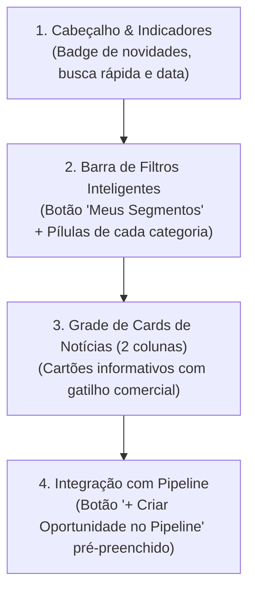

# Mockup: Seção "Radar de Mercado" no CRM RedeTV!

Abaixo apresentamos a proposta visual e funcional da nova seção de **Inteligência de Mercado & Radar Publicitário** desenhada sob medida para o CRM da RedeTV!.

---

## 🎨 Mockup Visual da Interface


---

## 🧱 Arquitetura dos Componentes de Interface (UI/UX)



---

### 1. Cabeçalho da Seção (Header)
* **Título:** `Radar de Mercado & Inteligência`
* **Badge Dinâmico:** `🔵 8 Novas Oportunidades Hoje` (com atualização diária às 08:00).
* **Filtros Temporais:** Seletor de data ("Hoje", "Últimos 7 dias", "Mês Atual").
* **Busca Textual:** Campo de pesquisa rápida por nome de marca, agência ou termo (ex: "Almap", "concorrência", "CMO").

---

### 2. Barra de Pílulas de Segmentos (Filtro por Carteira)
A barra superior traz atalhos rápidos com contadores:
* **`Todos (8)`** — Visão global de todas as oportunidades do dia (ideal para Diretores e Admins).
* **`⭐ Meus Segmentos (3)`** *(Em destaque)* — Filtra automaticamente apenas as notícias dos segmentos comerciais atribuídos ao executivo logado (conforme a regra BOLA/Carteira).
* **Pílulas por Segmento:**
  * `Petroquímica (1)`
  * `Tech e E-Commerce (1)`
  * `Apostas Esportivas (1)`
  * `Construção e Decoração (1)`
  * `Higiene e Beleza (2)`
  * `Financeiro e Seguros (1)`
  * `Eletro-Eletrônicos (1)`
  * `Agências de Publicidade`

---

### 3. Anatomia do Card de Notícia

Cada card foi projetado para leitura rápida em menos de **10 segundos** por um executivo de vendas:

```
┌────────────────────────────────────────────────────────────────────────┐
│ [🏷️ Petroquímica]                  PropMark • Há 2 horas  [🔗 Fonte]   │
│                                                                        │
│ AlmapBBDO assume conta de publicidade da Ipiranga após concorrência    │
│                                                                        │
│ ┌────────────────────────────────────────────────────────────────────┐ │
│ │ ⚡ GATILHO COMERCIAL                                               │ │
│ │ Troca de agência publicitária — janela aberta para apresentação de │ │
│ │ formatos na grade da RedeTV! antes do fechamento do split anual.   │ │
│ └────────────────────────────────────────────────────────────────────┘ │
│                                                                        │
│ A Ipiranga concluiu seu processo de concorrência e transferiu sua      │
│ conta para a AlmapBBDO. A agência planeja campanhas de varejo e massa. │
│                                                                        │
│ Anunciante: Ipiranga   |   Agência: AlmapBBDO                          │
│                                                                        │
│ [ + Criar Oportunidade no Pipeline ]              [ ↗ Ver Notícia ]    │
└────────────────────────────────────────────────────────────────────────┘
```

#### Destaques do Card:
1. **Badge do Segmento com cor temática:** Facilita a identificação visual imediata.
2. **Caixa de Destaque "Gatilho Comercial":** Fundo contrastante em amarelo/âmbar suave explicando **o porquê** aquela notícia importa para a meta de vendas.
3. **Resumo Executivo Objetivo:** 2 a 3 frases claras com os fatos essenciais.
4. **Metadados Comerciais:** Nome do anunciante e agência identificados.

---

### 4. A Grande Vantagem: Botão `+ Criar Oportunidade no Pipeline`

Ao clicar em **`+ Criar Oportunidade no Pipeline`** diretamente no card da notícia:
* O sistema abre o modal oficial de **Nova Oportunidade** do CRM já com os campos **automaticamente pré-preenchidos**:
  * **Título:** `Prospecção - Ipiranga (Nova Conta AlmapBBDO)`
  * **Anunciante:** Seleciona "Ipiranga" (se já existir no cadastro) ou sugere a criação.
  * **Agência:** Seleciona "AlmapBBDO".
  * **Executivo:** Vincula automaticamente ao executivo logado responsável pelo segmento de Petroquímica.
  * **Estágio Inicial:** `Prospecção` (Frio / Qualificação).
  * **Briefing:** Já preenche o histórico da notícia e a ação tática recomendada!
* O executivo só precisa revisar, definir uma meta de valor e salvar. O fato de mercado é transformado em pipeline em **menos de 15 segundos**!
