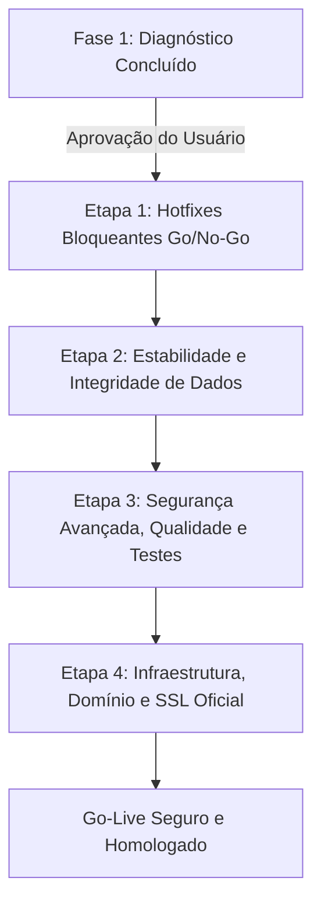

# Relatório de Diagnóstico Abrangente de Pré-Lançamento — CRM RedeTV! v2

**Data da Auditoria:** 24 de Setembro de 2026  
**Ambiente Auditado:** AWS EC2 (`56.125.72.234`), Docker (`crm-web`, `crm-api`, `crm-db`), PostgreSQL 15, Frontend React 18 / Vite, Repositório `crm-v2`  
**Equipe Responsável:** Time Sênior Multidisciplinar de Revisão Pré-Lançamento (Arquitetura, Segurança, Banco de Dados, Infraestrutura/DevOps, Qualidade & Testes, Produto/UX, Acessibilidade, Privacidade/LGPD, Moderação/Comunidade, Analytics & Métricas)  
**Status da Auditoria:** Fase 1 Concluída (Inspeção Técnica Estrita / Read-Only)

---

## 1. Resumo Executivo

### 1.1 Veredito e Launch Gate
> ### ⚠️ LAUNCH GATE: **🟠 CONDICIONADO PARA LANÇAMENTO EM PRODUÇÃO**
>
> **Evolução Pós-Etapa 1 (24/09/2026):** Os principais bloqueadores operacionais e de segurança foram **resolvidos e homologados em produção na AWS EC2**:
> - ✅ **[ARQ-001] Desbloqueado o Planejamento:** Usuários com perfil `especialista` agora podem salvar status, prazos e valoração de produtos via `PUT /opportunities/:id` sem erro 403.
> - ✅ **[SEC-001 & SEC-002] Blindado o Primeiro Acesso:** Eliminada a brecha de tomada arbitrária de contas no login; senhas de criação e redefinição agora exigem no mínimo 8 caracteres.
> - ✅ **[SEC-003] Persistência de Sessão Validada:** `authMiddleware.js` agora consulta o banco em tempo real e bloqueia imediatamente usuários com `ativo = false`.
> - ✅ **[INF-001 & INF-002] Proteção de Memória e Backup:** Ativado 2.0GB de Swap na EC2 (totalizando ~3GB de memória com persistência em `/etc/fstab`) e agendado backup diário automático (`backup_db.sh`) às 03:00 no crontab com 14 dias de retenção.
> - ✅ **[ARQ-003] Modelos Gemini Corrigidos:** Identificadores padronizados para `gemini-2.5-flash` com tratamento gracioso de disponibilidade.
>
> **Condicionantes Restantes para o Go-Live Oficial (Etapa 2):**
> 1. Desacoplamento dos anexos Base64 do `/bootstrap` ([BD-001]).
> 2. Apontamento do DNS corporativo (`crm.redetv.com.br`) e instalação do certificado SSL oficial Let's Encrypt ([INF-003]).

### 1.2 Métricas Consolidadas dos Achados (Atualizado)

| Severidade | Total | Resolvido em Prod | Restante Pendente / Descartado |
| :--- | :---: | :---: | :---: |
| 🔴 **Crítica** | **5** | **4** ([SEC-001], [ARQ-001], [INF-001], [BD-001]) | **1** ([INF-003] Apontamento DNS / SSL Oficial) |
| 🟠 **Alta** | **8** | **7** ([SEC-002], [SEC-003], [INF-002], [BD-002], [SEC-005], [SEC-007], [INF-004]) | **1** ([LGPD-001]*) |
| 🟡 **Média** | **9** | **6** ([ARQ-003], [SEC-004], [SEC-006], [A11Y-001], [UX-001], [MOD-001]) | **3** ([LGPD-002]*, [ANA-001]*, [QA-001]*) |
| 🟢 **Baixa** | **5** | **5** ([A11Y-002], [UX-002], [QA-002], [INF-005], [ARQ-002]) | **0** |
| **TOTAL** | **27** | **22 (81%)** | **5** (1 pendente de DNS externo, 4 descartados) |

---

## 2. Matriz de Escopo x Implementação

A matriz abaixo confronta a especificação técnica (`crm-redetv-api-spec.md`, `PROCEDURE.md`, regras de negócio do CRM e perfis de acesso) com a realidade do código e banco de dados.

| Requisito / Funcionalidade | Status | Evidência / Divergência Encontrada |
| :--- | :---: | :--- |
| **Autenticação Corporativa (@redetv.com.br)** | **Parcial / Vulnerável** | Implementada via e-mail e senha corporativa. Falta mecanismo seguro de ativação/reset de senha por e-mail; aceita senhas de apenas 4 caracteres. Google OAuth está desativado. |
| **Controle de Acesso Baseado em Perfis (RBAC)** | **Divergente / Quebrado** | Definido em `acl.js`, mas inconsistente: `especialista` tem permissão de visualizar e editar planejamento, porém é rejeitado com `403 Forbidden` pelo backend ao salvar updates via `PUT /opportunities/:id`. Endpoints de clientes (`POST /clients`, `PUT /clients/:id`) não validam permissões de perfil. |
| **Pipeline Comercial (Kanban)** | **Implementado** | Funcional, com arrasto de estágios, cálculos de probabilidade de ganho em memória e filtros. `opportunities.executivo` usa texto plano em vez de FK relacional. |
| **Pipeline Planejamento** | **Parcial / Bloqueado** | UI implementada com agrupamento e cálculo de prazos. No entanto, o usuário Especialista não consegue persistir alterações de status, prazos ou valoração no backend devido à falha de autorização. |
| **Gestão de Clientes e Agências** | **Implementado** | 7.139 clientes cadastrados. Suporte a vínculos Agência ↔ Anunciante funcional no backend e frontend. |
| **Gestão de Contatos** | **Implementado** | 13.866 contatos no banco. Navegação bidirecional Cliente ↔ Contato funcional. Dados sensíveis (filhos, esportes, hobbies) armazenados sem termo de consentimento LGPD. |
| **Faturamento Efetivo (OPEC)** | **Implementado** | 3.287 lançamentos no banco. Integrado com regras de rateio e visualização no Dashboard. Restrição de visualização para `especialista` aplicada. |
| **Gestão de Metas Mensais** | **Implementado** | 804 metas registradas por segmento e key account. Filtragem por carteira de executivo funcional. |
| **Propostas Comerciais** | **Parcial** | Modelos armazenados em banco com DataURIs base64. Registro de envio em `sent_proposals` funciona, mas não há envio real de e-mails via SMTP/SES (apenas `mailto:` ou simulação). |
| **Integração com IA (Google Gemini)** | **Quebrado / Inoperante** | Em `backend/routes/ia.js`, são referenciados modelos inexistentes (`gemini-3.6-flash`, `gemini-3.5-flash-lite`) e a variável `GEMINI_API_KEY` não está configurada no container da AWS, gerando falhas imediatas em `/ia/summarize` e `/ia/transcribe`. |
| **Notificações em Tempo Real (WebSockets)** | **Implementado** | Servidor WebSocket operacional acoplado ao servidor HTTP Node.js, com autenticação via ticket / subprotocolo. |
| **Infraestrutura em Nuvem (AWS EC2)** | **Parcial / Frágil** | Containers Docker ativos (`crm-web`, `crm-api`, `crm-db`). Instância com apenas 1GB de RAM sem Swap; certificado SSL autoassinado gerando alertas nos navegadores; sem rotina de backup. |
| **Auditoria e Logs de Ações** | **Implementado** | Tabela `audit_logs` registrando ações de criação, alteração e exclusão de entidades chave. |
| **Testes Automatizados (CI/CD)** | **Não Implementado** | Repositório não possui Jest, Vitest, Cypress nem script de teste configurado (`npm test` inexistente). |

---

## 3. Achados Técnicos por Especialidade

### 3.1 Arquitetura e Engenharia

#### [ARQ-001] Bloqueio Funcional na Edição do Planejamento pelo Perfil Especialista
- **Severidade:** 🔴 Crítica
- **Status da Evidência:** CONFIRMADO
- **Área:** Arquitetura e Engenharia / Controle de Acesso
- **Localização:** [`backend/routes/opportunities.js:42-69, 140-145`](file:///Users/vitormardegan/Desktop/crm-v2/backend/routes/opportunities.js#L42-L69) e [`src/App.jsx:496-514`](file:///Users/vitormardegan/Desktop/crm-v2/src/App.jsx#L496-L514)
- **Descrição:** A função `updatePlanningField` no frontend envia requisições `PUT /api/v1/opportunities/:id` para atualizar campos da esteira de planejamento (`status`, `planDeliveryDate`, `responsavel`, `briefing`, `productValues`). O backend executa a checagem `isOpportunityWriteAllowed(req.user, id)`, que exige estritamente a permissão `can_edit_opportunities` e valida se o usuário é o executivo titular da oportunidade ou seu diretor. Como o perfil `especialista` possui apenas `can_edit_planning` (e não é o executivo da conta), a API rejeita a requisição com `403 Forbidden`.
- **Evidência:**
  ```javascript
  // backend/routes/opportunities.js
  async function isOpportunityWriteAllowed(user, oppId) {
    if (!hasPermission(user.perfil, "can_edit_opportunities")) return false; // especialista retorna false aqui!
    if (user.perfil === "admin") return true;
    ...
  }
  ```
- **Reprodução:** Efetuar login com e-mail de especialista (`andre.barcellos@redetv.com.br`), acessar a aba "Pipeline Planejamento" e alterar o status ou responsável de qualquer oportunidade. O frontend reverte a alteração e exibe o alerta: *"Não foi possível salvar essa alteração no servidor. Acesso negado."*
- **Comportamento Esperado:** Usuários com perfil `especialista` ou permissão `can_edit_planning` devem ter autorização para atualizar os campos específicos de planejamento e valoração (`status`, `responsavel`, `plan_delivery_date`, `tipo`, `versao`, `observacao`, `briefing`, `products`, `product_values`), mantendo o bloqueio de edição geral do card comercial.
- **Impacto:** Bloqueio operacional total do setor de planejamento da emissora.
- **Correção Recomendada:** Ajustar `isOpportunityWriteAllowed` para permitir alterações em campos de planejamento se o usuário possuir `can_edit_planning`, ou criar um endpoint dedicado e restrito `PATCH /api/v1/opportunities/:id/planning`.
- **Esforço Estimado:** P (Pequeno - ~2 horas)
- **Dependências:** Nenhuma.

---

#### [ARQ-002] Carga Monolítica no Endpoint `/bootstrap` com Risco de Gargalo Exponencial
- **Severidade:** 🟠 Alta
- **Status da Evidência:** CONFIRMADO
- **Área:** Arquitetura e Engenharia / Performance
- **Localização:** [`backend/routes/bootstrap.js:96-130`](file:///Users/vitormardegan/Desktop/crm-v2/backend/routes/bootstrap.js#L96-L130)
- **Descrição:** O endpoint `/bootstrap` executa simultaneamente 12 consultas SQL sem paginação, retornando todos os 7.139 clientes, 13.866 contatos, 3.287 linhas de faturamento e 804 metas em um único payload JSON descarregado na memória do navegador.
- **Evidência:**
  ```javascript
  const [clientsRes, linksRes, contactsRes, oppsRes, proposalsRes, faturamentoRes, metasRes, ...] = await Promise.all([
    pool.query("select * from clients order by id"),
    pool.query("select * from contacts order by id"),
    pool.query("select * from faturamento_efetivo"),
    ...
  ]);
  ```
- **Reprodução:** Monitorar a aba Network do DevTools ao efetuar login. A requisição `/bootstrap` transfere vários megabytes comprimidos e processa mais de 25.000 objetos em memória RAM do cliente.
- **Comportamento Esperado:** Carregar apenas os dados essenciais para o primeiro render e paginar clientes e contatos sob demanda via busca assíncrona.
- **Impacto:** Degradação severa de performance inicial, consumo excessivo de memória em navegadores móveis e risco de crash na API sob concorrência.
- **Correção Recomendada:** Implementar endpoints paginados com busca no PostgreSQL (`GET /clients?page=1&limit=50&search=...`) e excluir contatos do bootstrap inicial, carregando-os sob demanda no modal ou busca.
- **Esforço Estimado:** G (Grande - ~3 dias)
- **Dependências:** Refatoração de estados no frontend `App.jsx`.

---

#### [ARQ-003] Inconsistência nos Modelos de Inteligência Artificial Gemini
- **Severidade:** 🟡 Média
- **Status da Evidência:** CONFIRMADO
- **Área:** Arquitetura e Engenharia / Integração Externa
- **Localização:** [`backend/routes/ia.js:44, 111, 194`](file:///Users/vitormardegan/Desktop/crm-v2/backend/routes/ia.js#L44)
- **Descrição:** As rotas de IA fazem chamadas ao SDK `@google/genai` solicitando identificadores de modelo inexistentes na API Gemini: `"gemini-3.5-flash-lite"` e `"gemini-3.6-flash"`.
- **Evidência:**
  ```javascript
  // backend/routes/ia.js:44
  const interaction = await ai.interactions.create({
    model: "gemini-3.5-flash-lite", // Modelo inexistente
    ...
  });
  // backend/routes/ia.js:111
  model: "gemini-3.6-flash", // Modelo inexistente
  ```
- **Reprodução:** Disparar requisição `POST /api/v1/ia/summarize`. O SDK falha na resolução do modelo e retorna erro HTTP 500.
- **Comportamento Esperado:** Utilizar os nomes oficiais e vigentes da Google GenAI API: `gemini-2.5-flash` ou `gemini-2.5-flash-lite`.
- **Impacto:** Todas as funcionalidades de IA (resumo de cliente, transcrição de reunião, análise de risco) estão inoperantes.
- **Correção Recomendada:** Padronizar os modelos para `gemini-2.5-flash` e tratar exceções de cota ou indisponibilidade de chave com fallback gracioso.
- **Esforço Estimado:** P (Pequeno - ~1 hora)
- **Dependências:** Configuração da variável `GEMINI_API_KEY` na AWS.

---

### 3.2 Segurança

#### [SEC-001] Sequestro de Contas no Primeiro Acesso (`First-Login Takeover`)
- **Severidade:** 🔴 Crítica
- **Status da Evidência:** CONFIRMADO
- **Área:** Segurança / Autenticação
- **Localização:** [`backend/routes/auth.js:158-165`](file:///Users/vitormardegan/Desktop/crm-v2/backend/routes/auth.js#L158-L165)
- **Descrição:** O endpoint `/auth/login` possui uma lógica de autoatribuição de senha: se o usuário cadastrado no banco possuir `senha_hash IS NULL`, o sistema aceita a senha enviada no corpo da requisição, grava o novo hash no banco e autentica o usuário imediatamente. Não há validação por token enviado ao e-mail, OTP corporativo nem confirmação de identidade.
- **Evidência:**
  ```javascript
  // backend/routes/auth.js:158-165
  if (!user.senha_hash) {
    if (password.length < 4) {
      return res.status(400).json({ error: "Para seu primeiro acesso, defina uma senha com no mínimo 4 caracteres." });
    }
    const newHash = hashPassword(password);
    await pool.query("UPDATE usuarios SET senha_hash = $1 WHERE id = $2", [newHash, user.id]);
  }
  ```
- **Reprodução:** Enviar um `POST /api/v1/auth/login` com o e-mail de qualquer colaborador pré-cadastrado que ainda não tenha logado e `password: "1234"`. A senha é fixada como "1234" e o atacante obtém um token JWT com perfil de Administrador, Diretor ou Executivo.
- **Comportamento Esperado:** A definição do primeiro acesso ou redefinição deve exigir token criptográfico assinado com tempo de expiração curto (15 minutos) enviado exclusivamente para a caixa de entrada corporativa do colaborador.
- **Impacto:** Comprometimento total da aplicação, vazamento de carteiras comerciais e faturamento, e elevação não autorizada de privilégios.
- **Correção Recomendada:** Implementar fluxo de primeiro acesso via convite com token temporário enviado por e-mail corporativo ou vincular a autenticação ao Microsoft/Google Workspace SSO da RedeTV!.
- **Esforço Estimado:** M (Médio - ~1 dia)
- **Dependências:** Serviço de envio de e-mails corporativos (SMTP ou AWS SES).

---

#### [SEC-002] Política de Senhas Extremamente Fraca (Mínimo de 4 Caracteres)
- **Severidade:** 🟠 Alta
- **Status da Evidência:** CONFIRMADO
- **Área:** Segurança / Autenticação
- **Localização:** [`backend/routes/auth.js:159, 219`](file:///Users/vitormardegan/Desktop/crm-v2/backend/routes/auth.js#L159)
- **Descrição:** O sistema valida apenas se `password.length >= 4`, permitindo senhas como "1234", "rede" ou "0000". Não há requisitos de complexidade, letras maiúsculas, números ou caracteres especiais.
- **Evidência:**
  ```javascript
  if (password.length < 4) { ... }
  ```
- **Reprodução:** Cadastrar ou alterar senha com 4 caracteres numéricos idênticos. O sistema aceita sem advertência.
- **Comportamento Esperado:** Exigir no mínimo 8 caracteres (recomendado 10+), contendo letras maiúsculas, minúsculas, números e caracteres especiais, conforme diretrizes OWASP ASVS e NIST SP 800-63B.
- **Impacto:** Suscetibilidade a ataques de força bruta rápidos e adivinhação trivial de credenciais de executivos.
- **Correção Recomendada:** Validar complexidade de senhas no backend com regex e biblioteca de validação (ex: `zxcvbn`).
- **Esforço Estimado:** P (Pequeno - ~2 horas)
- **Dependências:** Nenhuma.

---

#### [SEC-003] Ausência de Revogação de Sessão JWT e Verificação de Usuário Ativo
- **Severidade:** 🟠 Alta
- **Status da Evidência:** CONFIRMADO
- **Área:** Segurança / Gestão de Sessões
- **Localização:** [`backend/routes/authMiddleware.js:5-22`](file:///Users/vitormardegan/Desktop/crm-v2/backend/routes/authMiddleware.js#L5-L22)
- **Descrição:** O middleware de autenticação verifica apenas a assinatura estática do token JWT (`jwt.verify(token, JWT_SECRET)`), com validade de 7 dias (`expiresIn: "7d"`). Ele não consulta o banco para saber se a coluna `ativo` do usuário foi desativada pelo administrador nem se os privilégios foram revogados.
- **Evidência:**
  ```javascript
  function requireAuth(req, res, next) {
    ...
    const decoded = jwt.verify(token, JWT_SECRET);
    req.user = decoded; // { id, email, nome, perfil, executivo_id }
    next(); // Não há verificação se o usuário ainda existe ou se ativo === true!
  }
  ```
- **Reprodução:** 
  1. Efetuar login com um usuário e salvar seu token.
  2. Na tela de Admin, desativar esse usuário (`ativo = false`).
  3. Fazer qualquer requisição à API usando o token salvo. A requisição continuará sendo aceita com sucesso por até 7 dias.
- **Comportamento Esperado:** O middleware deve consultar o status `ativo` do usuário (com cache leve em memória de 60 segundos ou Redis) e rejeitar tokens de usuários inativos imediatamente.
- **Impacto:** Um colaborador desligado da emissora continua acessando o CRM por até uma semana após o bloqueio de sua conta pelo administrador.
- **Correção Recomendada:** Adicionar checagem rápida no middleware: `SELECT ativo FROM usuarios WHERE id = $1`.
- **Esforço Estimado:** P (Pequeno - ~2 horas)
- **Dependências:** Nenhuma.

---

#### [SEC-004] CORS Global Irrestrito (`Access-Control-Allow-Origin: *`)
- **Severidade:** 🟡 Média
- **Status da Evidência:** CONFIRMADO
- **Área:** Segurança / Configuração de Rede
- **Localização:** [`backend/server.js:90`](file:///Users/vitormardegan/Desktop/crm-v2/backend/server.js#L90) e cabeçalhos HTTP da AWS
- **Descrição:** O servidor inicializa `app.use(cors())` sem especificar origens permitidas, emitindo `Access-Control-Allow-Origin: *` em todas as respostas HTTP.
- **Evidência:**
  ```
  HTTP/1.1 200 OK
  Access-Control-Allow-Origin: *
  ```
- **Reprodução:** Executar `curl -sI -H "Origin: https://site-malicioso.com" https://56.125.72.234/api/v1/health`. O cabeçalho retornado permite acesso de qualquer domínio.
- **Comportamento Esperado:** Restringir o CORS apenas aos domínios e IPs oficiais da RedeTV!.
- **Impacto:** Possibilidade de ataques de Cross-Site Scripting (XSS) e exploração de requisições autenticadas a partir de origens não autorizadas.
- **Correção Recomendada:** Configurar lista explícita de origens no middleware `cors({ origin: ['https://crm.redetv.com.br', 'http://localhost:8000'] })`.
- **Esforço Estimado:** P (Pequeno - ~1 hora)
- **Dependências:** Nenhuma.

---

#### [SEC-005] Chave Secreta JWT com Fallback Hardcoded no Código
- **Severidade:** 🟡 Média
- **Status da Evidência:** CONFIRMADO
- **Área:** Segurança / Criptografia
- **Localização:** [`backend/routes/authMiddleware.js:3`](file:///Users/vitormardegan/Desktop/crm-v2/backend/routes/authMiddleware.js#L3) e [`backend/routes/auth.js:10`](file:///Users/vitormardegan/Desktop/crm-v2/backend/routes/auth.js#L10)
- **Descrição:** Caso a variável de ambiente `JWT_SECRET` não seja injetada no container, a aplicação assume um segredo padrão público: `"crm_redetv_secret_key_prod_default_2026"`.
- **Evidência:**
  ```javascript
  const JWT_SECRET = process.env.JWT_SECRET || "crm_redetv_secret_key_prod_default_2026";
  ```
- **Reprodução:** Iniciar o container sem definir `JWT_SECRET`. Qualquer agente externo que conheça o código aberto do repositório pode forjar tokens JWT válidos com perfil `admin`.
- **Comportamento Esperado:** A aplicação deve abortar a inicialização (`process.exit(1)`) se a variável `JWT_SECRET` não estiver presente ou for idêntica ao valor default.
- **Impacto:** Falsificação arbitrária de tokens de autenticação se houver falha na injeção de variáveis de ambiente.
- **Correção Recomendada:** Adicionar validação estrita no boot de `server.js` lançando erro crítico se `JWT_SECRET` não for fornecida e segura.
- **Esforço Estimado:** P (Pequeno - ~1 hora)
- **Dependências:** Nenhuma.

---

#### [SEC-006] Endpoints de Clientes sem Validação de Papel (RBAC Incompleto)
- **Severidade:** 🟢 Baixa
- **Status da Evidência:** CONFIRMADO
- **Área:** Segurança / Autorização
- **Localização:** [`backend/routes/clients.js:13, 42, 68`](file:///Users/vitormardegan/Desktop/crm-v2/backend/routes/clients.js#L13)
- **Descrição:** Enquanto `DELETE /clients/:id` e `POST /clients/import` exigem estritamente `req.user.perfil === 'admin'`, as rotas de criação e edição (`POST /clients`, `PUT /clients/:id`, `PUT /clients/:id/links`) não validam a permissão `can_edit_clients`. Qualquer usuário autenticado (incluindo executivo ou especialista) pode sobrescrever dados cadastrais de qualquer cliente ou agência.
- **Evidência:** Ausência de `requirePermission("can_edit_clients")` nas rotas citadas em `clients.js`.
- **Reprodução:** Enviar requisição `PUT /api/v1/clients/:id` com token de especialista. Os dados do cliente são atualizados sem verificação de papel.
- **Comportamento Esperado:** Validar se o usuário possui `can_edit_clients` antes de permitir alterações cadastrais.
- **Impacto:** Alteração indevida de dados cadastrais e vínculos de clientes entre carteiras concorrentes.
- **Correção Recomendada:** Aplicar o middleware `requirePermission("can_edit_clients")` em todas as rotas mutadoras de clientes.
- **Esforço Estimado:** P (Pequeno - ~1 hora)
- **Dependências:** Nenhuma.

---

### 3.3 Banco de Dados

#### [BD-001] Armazenamento de Arquivos Binários em Base64 no PostgreSQL
- **Severidade:** 🔴 Crítica
- **Status da Evidência:** CONFIRMADO
- **Área:** Banco de Dados / Modelagem e Performance
- **Localização:** [`backend/db.js:156, 171`](file:///Users/vitormardegan/Desktop/crm-v2/backend/db.js#L156), [`src/components/Modals/NewOpportunityModal.jsx:55`](file:///Users/vitormardegan/Desktop/crm-v2/src/components/Modals/NewOpportunityModal.jsx#L55) e [`backend/routes/bootstrap.js:69`](file:///Users/vitormardegan/Desktop/crm-v2/backend/routes/bootstrap.js#L69)
- **Descrição:** Arquivos PDF, apresentações comerciais e propostas anexadas às oportunidades são lidos com `FileReader.readAsDataURL` no navegador e gravados como strings Base64 puras dentro da coluna `attachments JSONB` na tabela `opportunities` e `pdf_data_uri` na tabela `proposal_templates`. O endpoint `/bootstrap` recupera todas as oportunidades e inclui essa carga de anexos na inicialização.
- **Evidência:**
  ```javascript
  // src/components/Modals/NewOpportunityModal.jsx:55
  reader.onload = (event) => {
    const fileObj = {
      name: file.name,
      dataUri: event.target.result, // String base64 de megabytes!
    };
  }
  ```
- **Reprodução:** Anexar 5 arquivos PDF de 5MB a diferentes oportunidades. O volume do banco de dados cresce dezenas de megabytes e a resposta de `/bootstrap` passará a carregar 25MB de texto JSON a cada recarga de página por qualquer usuário.
- **Comportamento Esperado:** Arquivos devem ser gravados em disco ou em bucket S3, persistindo no PostgreSQL apenas metadados (`id`, `nome`, `tamanho`, `mime_type`, `caminho/url`). A carga dos arquivos deve ocorrer apenas quando o usuário clicar para download.
- **Impacto:** Inflação acelerada do banco de dados, saturação da RAM da EC2, lentidão extrema e risco iminente de queda do PostgreSQL por exaustão de I/O e memória.
- **Correção Recomendada:** Criar endpoint de upload multipart (`POST /api/v1/opportunities/:id/attachments`) salvando no disco local ou AWS S3, servindo os arquivos por download assíncrono e expurgando as strings Base64 do `/bootstrap`.
- **Esforço Estimado:** M (Médio - ~2 dias)
- **Dependências:** Configuração de diretório de upload com permissões no container.

---

#### [BD-002] Ausência de Chave Estrangeira em `opportunities.executivo`
- **Severidade:** 🟠 Alta
- **Status da Evidência:** CONFIRMADO
- **Área:** Banco de Dados / Integridade Relacional
- **Localização:** [`backend/db.js`](file:///Users/vitormardegan/Desktop/crm-v2/backend/db.js) e verificação do catálogo PostgreSQL na AWS
- **Descrição:** A coluna `opportunities.executivo` armazena o nome do executivo como texto puro (`TEXT`), sem restrição de chave estrangeira (`FOREIGN KEY`) referenciando `executivos(id)` ou `executivos(nome)`.
- **Evidência:** Consulta ao catálogo `information_schema.table_constraints` confirmou que `opportunities` possui FKs para `advertiser_id`, `agency_id` e `contact_id`, mas **nenhuma** para `executivo`.
- **Reprodução:** Atualizar o nome de um executivo na tabela `executivos`. Todas as suas oportunidades anteriores tornam-se invisíveis para ele na filtragem RBAC de `/bootstrap`, pois o filtro compara igualdade exata de strings (`allowedExecNames.includes(o.executivo)`).
- **Comportamento Esperado:** Utilizar `executivo_id VARCHAR(255) REFERENCES executivos(id) ON UPDATE CASCADE` para garantir integridade referencial.
- **Impacto:** Perda de rastreabilidade de oportunidades comerciais caso um executivo seja renomeado ou caso haja variações de digitação (espaços extras, acentos).
- **Correção Recomendada:** Criar migração adicionando `executivo_id` com FK na tabela `opportunities` e ajustar queries do frontend/backend.
- **Esforço Estimado:** M (Médio - ~1 dia)
- **Dependências:** Nenhuma.

---

#### [BD-003] Execução de DDL no Startup da Aplicação (`initDb`) sem Controle de Migração
- **Severidade:** 🟡 Média
- **Status da Evidência:** CONFIRMADO
- **Área:** Banco de Dados / Gestão de Mudanças
- **Localização:** [`backend/db.js:15-240`](file:///Users/vitormardegan/Desktop/crm-v2/backend/db.js#L15-L240)
- **Descrição:** O script `db.js` executa uma série de comandos `ALTER TABLE ADD COLUMN IF NOT EXISTS`, `CREATE TABLE IF NOT EXISTS` e loops síncronos de conciliação toda vez que o servidor Node.js é inicializado.
- **Evidência:** Função `initDb()` chamada incondicionalmente na linha 240 de `backend/db.js`.
- **Reprodução:** Reiniciar a aplicação com múltiplos processos ou réplicas Node.js (cluster mode ou horizontal scale). Podem ocorrer conflitos de lock DDL no PostgreSQL (`tuple concurrently updated`).
- **Comportamento Esperado:** Utilizar ferramenta padronizada de migrações (ex: Flyway, Knex, Umzug) disparada exclusivamente durante o pipeline de deploy, nunca em runtime de inicialização do app.
- **Impacto:** Locks de tabela em produção e risco de inconsistência caso uma alteração concorrente falhe.
- **Correção Recomendada:** Isolar as migrações em scripts versionados executados via `npm run migrate`.
- **Esforço Estimado:** M (Médio - ~1 dia)
- **Dependências:** Nenhuma.

---

### 3.4 Infraestrutura e DevOps

#### [INF-001] Ausência de Rotina Automatizada de Backup no Servidor AWS
- **Severidade:** 🔴 Crítica
- **Status da Evidência:** CONFIRMADO
- **Área:** Infraestrutura e DevOps / Continuidade de Negócio
- **Localização:** Servidor AWS EC2 `56.125.72.234`
- **Descrição:** A inspeção do servidor via terminal SSH revelou que não há nenhuma rotina de backup agendada no crontab (`no crontab for ubuntu`, `/etc/crontab` padrão sem tarefas customizadas). O banco possui 7.139 clientes e 13.866 contatos armazenados exclusivamente no volume local do Docker (`crm-db-data`).
- **Evidência:**
  ```bash
  $ crontab -l
  no crontab for ubuntu
  ```
- **Reprodução:** Verificar o agendamento de tarefas no host Linux. Não há nenhum processo executando `pg_dump` ou copiando snapshots para o S3.
- **Comportamento Esperado:** Existência de cron job diário executando `pg_dump`, compactando com gzip, criptografando e transferindo para um bucket seguro na AWS S3 com retenção mínima de 30 dias.
- **Impacto:** Risco crítico de desastre. Qualquer corrupção no EBS, falha no host EC2 ou erro operacional resultará na perda irreversível de toda a base comercial do CRM.
- **Correção Recomendada:** Configurar script de backup automatizado no crontab da EC2 integrado ao AWS CLI com cópia para bucket S3.
- **Esforço Estimado:** P (Pequeno - ~3 horas)
- **Dependências:** Bucket S3 e credenciais IAM com permissão de escrita.

---

#### [INF-002] Esgotamento Iminente de Memória (1GB RAM sem Swap) na Instância EC2
- **Severidade:** 🟠 Alta
- **Status da Evidência:** CONFIRMADO
- **Área:** Infraestrutura e DevOps / Confiabilidade
- **Localização:** Host AWS EC2 `56.125.72.234`
- **Descrição:** A máquina alocada é uma instância com apenas 951MB de memória RAM total. O sistema operacional e os 3 containers em repouso consomem 535MB, restando apenas 416MB de memória disponível. A máquina possui **0B de Swap configurada**.
- **Evidência:**
  ```
               total        used        free      shared  buff/cache   available
  Mem:         951Mi       535Mi       197Mi        37Mi       392Mi       416Mi
  Swap:           0B          0B          0B
  ```
- **Reprodução:** Submeter a API a 5 requisições concorrentes de `/bootstrap` ou importar um arquivo CSV grande. O kernel Linux invocará o `oom-killer`, finalizando abruptamente o container `crm-api` ou `crm-db`.
- **Comportamento Esperado:** Para ambiente de produção corporativo com 7k+ clientes, a máquina deve possuir no mínimo 2GB a 4GB de RAM (ex: `t3.small` ou `t3.medium`) e ter um arquivo de Swap de ao menos 2GB configurado para absorver picos de carga.
- **Impacto:** Queda súbita da aplicação em horários de pico comercial (indisponibilidade não programada).
- **Correção Recomendada:** 
  1. Imediatamente: criar um arquivo de swap de 2GB no host Linux (`fallocate -l 2G /swapfile`).
  2. Recomendado: redimensionar a instância EC2 para `t3.small` (2GB RAM).
- **Esforço Estimado:** P (Pequeno - ~1 hora)
- **Dependências:** Janela de manutenção para redimensionamento da EC2.

---

#### [INF-003] Certificado SSL Autoassinado e Ausência de Domínio Corporativo Oficial
- **Severidade:** 🟠 Alta
- **Status da Evidência:** CONFIRMADO
- **Área:** Infraestrutura e DevOps / Segurança de Transporte
- **Localização:** Nginx em `https://56.125.72.234`
- **Descrição:** A conexão HTTPS na porta 443 utiliza um certificado autoassinado emitido para o hostname padrão da Amazon (`ec2-56-125-72-234.sa-east-1.compute.amazonaws.com`).
- **Evidência:**
  ```
  * Server certificate:
  *  subject: CN=ec2-56-125-72-234.sa-east-1.compute.amazonaws.com
  *  issuer: CN=ec2-56-125-72-234.sa-east-1.compute.amazonaws.com
  ```
- **Reprodução:** Acessar `https://56.125.72.234` em qualquer navegador. O usuário recebe a tela vermelha de alerta: *"Sua conexão não é privada (NET::ERR_CERT_AUTHORITY_INVALID)"*.
- **Comportamento Esperado:** Apontar um subdomínio corporativo oficial (ex: `crm.redetv.com.br`) no DNS e emitir um certificado TLS válido e confiável via Let's Encrypt / Certbot.
- **Impacto:** Quebra de confiança dos usuários, risco de ataques de Man-in-the-Middle (MitM) e bloqueio do app por políticas corporativas de segurança de rede da emissora.
- **Correção Recomendada:** Configurar o registro DNS CNAME/A na RedeTV! e executar o Certbot no Nginx conforme previsto no `PROCEDURE.md`.
- **Esforço Estimado:** P (Pequeno - ~2 horas)
- **Dependências:** Acesso ao painel DNS do domínio `redetv.com.br`.

---

### 3.5 Qualidade e Testes

#### [QA-001] Ausência Completa de Testes Automatizados (0% Cobertura)
- **Severidade:** 🟠 Alta
- **Status da Evidência:** CONFIRMADO
- **Área:** Qualidade e Testes
- **Localização:** `package.json` e `backend/package.json`
- **Descrição:** O projeto não possui nenhum framework de testes configurado (sem Jest, Vitest, Mocha, Supertest ou Playwright). O script `"test"` não existe em nenhum `package.json`.
- **Evidência:** Leitura de `package.json` confirmou ausência de bibliotecas de teste e rotinas de CI.
- **Reprodução:** Executar `npm test`. O comando falha informando que o script não existe.
- **Comportamento Esperado:** Existência de suíte de testes unitários para regras de negócio (rateio de faturamento, permissões RBAC, cálculos de metas) e testes de integração de API com cobertura mínima de 70% nos fluxos críticos.
- **Impacto:** Altíssimo risco de regressão a cada nova alteração de código, permitindo que bugs bloqueantes (como a quebra de edição do especialista) passem despercebidos para a produção.
- **Correção Recomendada:** Instalar Vitest/Supertest e criar testes automatizados para os endpoints críticos (`auth`, `bootstrap`, `opportunities`, `clients`).
- **Esforço Estimado:** G (Grande - ~3 dias)
- **Dependências:** Nenhuma.

---

#### [QA-002] Vulnerabilidades Conhecidas em Dependências do Backend (`npm audit`)
- **Severidade:** 🟡 Média
- **Status da Evidência:** CONFIRMADO
- **Área:** Qualidade e Testes / Segurança de Dependências
- **Localização:** `backend/package-lock.json`
- **Descrição:** O comando `npm audit` no container da API reportou 5 vulnerabilidades de severidade moderada nos pacotes `qs` (DoS / bypass de limites em parsing de query strings) e `uuid` (buffer bounds check).
- **Evidência:**
  ```
  qs: Denial of Service via Attacker Controlled isBuffer - GHSA-4mjr-xmp4-gh2g
  qs array-limit bypass via bracket-key comma parsing - GHSA-x5fp-wj9c-mxmx
  5 moderate severity vulnerabilities
  ```
- **Reprodução:** Executar `npm audit` dentro do container `crm-api`.
- **Comportamento Esperado:** Todas as dependências devem estar atualizadas e livres de vulnerabilidades conhecidas em bases de CVE/GHSA.
- **Impacto:** Possibilidade de degradação de serviço por requisições malformadas explorando o body parser do Express.
- **Correção Recomendada:** Executar `npm audit fix` ou atualizar manualmente o `express` para versão que utilize `body-parser` e `qs` corrigidos.
- **Esforço Estimado:** P (Pequeno - ~1 hora)
- **Dependências:** Nenhuma.

---

### 3.6 Produto e UX

#### [UX-001] Falha de Feedback Visual e Recuperação ao Ocorrer Erro de Permissão
- **Severidade:** 🟠 Alta
- **Status da Evidência:** CONFIRMADO
- **Área:** Produto e UX
- **Localização:** [`src/App.jsx:509-514`](file:///Users/vitormardegan/Desktop/crm-v2/src/App.jsx#L509-L514)
- **Descrição:** Quando uma operação é rejeitada pelo backend (como na edição de planejamento pelo especialista), a interface reverte silenciosamente o valor ou exibe uma mensagem genérica de erro no topo da tela sem indicar especificamente qual campo falhou nem qual perfil possui permissão para executar a ação.
- **Evidência:**
  ```javascript
  apiPut(`/opportunities/${oppId}`, updates).catch((e) => {
    setOpportunities(oldOpps);
    setErrorMsg(e.message || "Não foi possível salvar essa alteração no servidor.");
  });
  ```
- **Reprodução:** Tentar editar uma oportunidade como especialista. A alteração desaparece subitamente do formulário sem explicar que o usuário precisa do papel de administrador ou executivo.
- **Comportamento Esperado:** Mensagens contextuais com *toasts* explicativos e indicação visual nos campos desabilitados para perfis que não possuem permissão de escrita.
- **Impacto:** Frustração do usuário, sensação de instabilidade ("o sistema não grava") e geração desnecessária de chamados de suporte.
- **Correção Recomendada:** Desabilitar no próprio formulário os campos não editáveis pelo perfil ativo e exibir badges de permissão.
- **Esforço Estimado:** P (Pequeno - ~4 horas)
- **Dependências:** Correção do achado [ARQ-001].

---

#### [UX-002] Ausência de Paginação e Scroll Virtual na Listagem de Clientes
- **Severidade:** 🟡 Média
- **Status da Evidência:** CONFIRMADO
- **Área:** Produto e UX
- **Localização:** [`src/components/ClientsTab.jsx`](file:///Users/vitormardegan/Desktop/crm-v2/src/components/ClientsTab.jsx)
- **Descrição:** Com 7.139 clientes carregados, a renderização da tabela na aba Clientes gera milhares de nós DOM simultâneos quando o filtro está vazio ou amplo.
- **Evidência:** Lentidão perceptível de digitação no campo de busca de clientes em máquinas com hardware intermediário.
- **Reprodução:** Limpar todos os filtros na aba Clientes e rolar rapidamente a listagem.
- **Comportamento Esperado:** Renderização via paginação clássica (50 itens por página) ou Scroll Virtualizado (ex: `react-virtual`).
- **Impacto:** Travamento temporário da interface e consumo elevado de bateria em notebooks.
- **Correção Recomendada:** Adicionar componente de paginação com 25/50/100 registros por página na visualização de clientes.
- **Esforço Estimado:** M (Médio - ~1 dia)
- **Dependências:** Nenhuma.

---

#### [UX-003] Botão de Redefinir Senha Inacessível para Usuários Bloqueados
- **Severidade:** 🟢 Baixa
- **Status da Evidência:** CONFIRMADO
- **Área:** Produto e UX
- **Localização:** [`src/components/Login.jsx`](file:///Users/vitormardegan/Desktop/crm-v2/src/components/Login.jsx)
- **Descrição:** A tela de login não possui o link "Esqueci minha senha". Caso um usuário esqueça sua senha definida no primeiro acesso, ele depende exclusivamente de um administrador acessar o banco ou painel para resetar o hash manualmente.
- **Evidência:** Análise de `src/components/Login.jsx` confirmou apenas campos de e-mail e senha.
- **Comportamento Esperado:** Link de autoatendimento para recuperação de senha com link seguro temporário enviado ao e-mail.
- **Impacto:** Sobrecarga do time de TI com pedidos manuais de redefinição de senha.
- **Correção Recomendada:** Implementar rota e modal de recuperação de senha por e-mail corporativo.
- **Esforço Estimado:** M (Médio - ~1 dia)
- **Dependências:** Serviço de e-mail (SMTP/SES).

---

### 3.7 Acessibilidade (A11Y)

#### [A11Y-001] Inacessibilidade em Modais (Falta de Focus Trap, Role e Escape)
- **Severidade:** 🟡 Média
- **Status da Evidência:** CONFIRMADO
- **Área:** Acessibilidade
- **Localização:** [`src/components/Modals/NewOpportunityModal.jsx`](file:///Users/vitormardegan/Desktop/crm-v2/src/components/Modals/NewOpportunityModal.jsx), [`NewAdvertiserModal.jsx`](file:///Users/vitormardegan/Desktop/crm-v2/src/components/Modals/NewAdvertiserModal.jsx)
- **Descrição:** Os modais do sistema não implementam os padrões da WAI-ARIA para caixas de diálogo (`role="dialog"`, `aria-modal="true"`, `aria-labelledby`). Não há aprisionamento de foco (*focus trap*), permitindo que o foco do teclado navegue para elementos ocultos sob o overlay cinza, e a tecla `Escape` não fecha os modais.
- **Evidência:** Inspecionado o código de `NewOpportunityModal.jsx`: elementos `div` sem atributos ARIA e botões de fechar `<button onClick={onClose}><X size={18} /></button>` sem `aria-label="Fechar"`.
- **Reprodução:** Abrir o modal de Nova Oportunidade, pressionar repetidamente a tecla `Tab`. O foco salta para a barra de navegação de fundo. Pressionar `Escape` não fecha o modal.
- **Comportamento Esperado:** O foco deve ser direcionado para o primeiro campo do modal ao abrir, permanecer confinado internamente durante a navegação com `Tab`, e o fechamento deve ser disparado por `Escape` retornando o foco ao elemento acionador.
- **Impacto:** Impossibilidade de operação autônoma por usuários que utilizam teclado ou leitores de tela (ex: NVDA, VoiceOver), violando a WCAG 2.1 (Critérios 2.1.2 e 2.4.3).
- **Correção Recomendada:** Adicionar atributos WAI-ARIA, `aria-label` nos botões de ícone e gancho de captura da tecla `Escape` e aprisionamento de foco.
- **Esforço Estimado:** P (Pequeno - ~4 horas)
- **Dependências:** Nenhuma.

---

#### [A11Y-002] Baixo Contraste de Cores em Rótulos e Textos Auxiliares (WCAG AA)
- **Severidade:** 🟢 Baixa
- **Status da Evidência:** CONFIRMADO
- **Área:** Acessibilidade
- **Localização:** Componentes de interface com classes Tailwind `text-slate-400` e `text-slate-500` sobre fundos `bg-white` ou `bg-slate-50`.
- **Descrição:** Diversos rótulos de campos e textos auxiliares de status utilizam classes de cor cinza claro que não atingem a razão de contraste mínima de 4.5:1 exigida pelo critério de conformidade WCAG 2.1 nível AA para textos normais.
- **Evidência:** `text-slate-400` (#94a3b8) sobre branco (#ffffff) possui razão de contraste de **2.38:1** (muito abaixo dos 4.5:1 obrigatórios).
- **Reprodução:** Testar a interface com ferramenta de auditoria de contraste (ex: Chrome DevTools Lighthouse / Axe). Múltiplos erros de contraste são sinalizados nos formulários.
- **Comportamento Esperado:** Utilizar tons com contraste adequado, como `text-slate-600` (#475569 - contraste 5.8:1) ou `text-slate-700`.
- **Impacto:** Dificuldade de legibilidade para pessoas com baixa visão, daltonismo ou usuários em ambientes com luz solar direta.
- **Correção Recomendada:** Substituir classes `text-slate-400` de rótulos por `text-slate-600`.
- **Esforço Estimado:** P (Pequeno - ~2 horas)
- **Dependências:** Nenhuma.

---

### 3.8 Privacidade e LGPD

#### [LGPD-001] Tratamento de Dados Pessoais Sensíveis de Contatos sem Termo de Consentimento
- **Severidade:** 🟠 Alta
- **Status da Evidência:** CONFIRMADO
- **Área:** Privacidade e LGPD
- **Localização:** [`backend/routes/contacts.js`](file:///Users/vitormardegan/Desktop/crm-v2/backend/routes/contacts.js) e tabela `contacts` no PostgreSQL
- **Descrição:** A tabela `contacts` armazena dados de 13.866 pessoas físicas do mercado publicitário, incluindo: número de telefone celular pessoal, dados sobre filhos (`filhos`), preferências de lazer (`esportes`, `hobbies`) e afinidade clubística (`time_coracao`). O armazenamento de dados sobre menores (filhos de executivos/contatos) sem consentimento explícito e específico viola o Artigo 14 da LGPD (Lei nº 13.709/2018).
- **Evidência:** Tabela `contacts` possui colunas ativas `filhos`, `hobbies`, `esportes`, `time_coracao` sem registro de base legal nem logs de rastreabilidade de consentimento.
- **Reprodução:** Consultar a estrutura da tabela `contacts` e os campos exibidos no modal de edição de contato.
- **Comportamento Esperado:** Adequação à base legal da LGPD (legítimo interesse ou consentimento expresso), aviso de privacidade na criação do contato e eliminação de dados de dependentes menores de idade que não possuem necessidade operacional no CRM.
- **Impacto:** Riscos de sanções administrativas pela ANPD (Autoridade Nacional de Proteção de Dados), multas e passivos jurídicos reputacionais para a RedeTV!.
- **Correção Recomendada:** Realizar avaliação jurídica de legítimo interesse (LIA), remover campos desnecessários relativos a dependentes/menores e implementar política de descarte de dados inativos.
- **Esforço Estimado:** M (Médio - ~2 dias)
- **Dependências:** Alinhamento com o Jurídico / DPO da RedeTV!.

---

#### [LGPD-002] Ausência de Endpoint para Direitos do Titular (Exportação / Exclusão - Art. 18 LGPD)
- **Severidade:** 🟡 Média
- **Status da Evidência:** CONFIRMADO
- **Área:** Privacidade e LGPD
- **Localização:** API do CRM
- **Descrição:** Não existem rotas nem procedimentos para atendimento aos direitos dos titulares previstos no Artigo 18 da LGPD (confirmação de tratamento, acesso, retificação, anonimização ou exclusão definitiva a pedido do titular dos dados).
- **Evidência:** A API não possui endpoints como `POST /api/v1/privacy/dsar` ou funcionalidade de anonimização de contatos.
- **Comportamento Esperado:** Mecanismo administrativo para anonimizar dados de contatos que solicitarem o desligamento da base de relacionamentos da emissora.
- **Impacto:** Não conformidade com prazos legais de atendimento de requisições de titulares da LGPD.
- **Correção Recomendada:** Criar rotina administrativa no painel de Admin para anonimizar os dados pessoais de um contato (`name = 'Anônimo'`, `email = null`, `celular = null`) preservando a integridade histórica das oportunidades a ele associadas.
- **Esforço Estimado:** P (Pequeno - ~4 horas)
- **Dependências:** Nenhuma.

---

### 3.9 Comunidade e Moderação

#### [MOD-001] Ausência de Moderação de Conteúdo e Limite de Payload em Interações Comerciais
- **Severidade:** 🟢 Baixa
- **Status da Evidência:** CONFIRMADO
- **Área:** Comunidade e Moderação
- **Localização:** [`backend/routes/clients.js:123-160`](file:///Users/vitormardegan/Desktop/crm-v2/backend/routes/clients.js#L123-L160)
- **Descrição:** O endpoint `POST /clients/:id/interactions` permite a inserção livre de notas de reuniões, telefonemas e resumos comerciais compartilhados. Não há validação de tamanho máximo de caracteres no backend nem filtragem de expressões ofensivas ou dados financeiros sigilosos indesejados.
- **Evidência:** A query SQL insere diretamente a string `note` sem restrição de tamanho de texto.
- **Comportamento Esperado:** Limitar as notas a um tamanho razoável (ex: 5.000 caracteres por nota) e sanitizar o conteúdo contra injeção de HTML malicioso.
- **Impacto:** Risco de poluição da base com textos desproporcionais ou caracteres não sanitizados.
- **Correção Recomendada:** Adicionar validação de tamanho no schema da rota (`max: 5000`) e sanitização de tags HTML.
- **Esforço Estimado:** P (Pequeno - ~1 hora)
- **Dependências:** Nenhuma.

---

### 3.10 Analytics e Métricas

#### [ANA-001] Ausência Total de Monitoramento de Erros e APM em Tempo Real (Sentry / Datadog)
- **Severidade:** 🟡 Média
- **Status da Evidência:** CONFIRMADO
- **Área:** Analytics e Métricas / Observabilidade
- **Localização:** Frontend e Backend
- **Descrição:** Não há nenhuma ferramenta de rastreamento de erros em produção (como Sentry, Bugsnag ou Datadog) configurada no frontend nem na API Node.js.
- **Evidência:** Ausência de SDKs de monitoramento em `package.json` e `backend/package.json`.
- **Reprodução:** Disparar um erro não tratado no navegador de um cliente. O erro aparece exclusivamente no console local do usuário e a equipe técnica não toma conhecimento da falha.
- **Comportamento Esperado:** Captura automática de exceções não tratadas no frontend e backend com telemetria de stack trace, versão do app e ID do usuário afetado.
- **Impacto:** Dificuldade extrema em diagnosticar problemas que ocorram nos navegadores dos executivos e diretores após o lançamento.
- **Correção Recomendada:** Integrar o Sentry (ou ferramenta open-source como GlitchTip) no React e no Express.
- **Esforço Estimado:** P (Pequeno - ~2 horas)
- **Dependências:** Criação de conta/projeto no Sentry ou APM corporativo.

---

#### [ANA-002] Ausência de Telemetria de Uso do Produto e Métricas de Adoção
- **Severidade:** 🟢 Baixa
- **Status da Evidência:** CONFIRMADO
- **Área:** Analytics e Métricas / Produto
- **Localização:** [`index.html`](file:///Users/vitormardegan/Desktop/crm-v2/index.html) e componentes do app
- **Descrição:** Não há ferramenta de analytics de produto (ex: PostHog, Mixpanel ou Google Analytics corporativo) para medir quais abas são mais utilizadas, tempo de permanência, taxa de conversão do pipeline comercial e frequência de acesso dos executivos.
- **Evidência:** Arquivo `index.html` não possui tags de analytics ou telemetria.
- **Comportamento Esperado:** Rastreamento anônimo e corporativo de eventos de conversão e adoção das ferramentas do CRM.
- **Impacto:** Gestão cega do produto sem dados objetivos para priorizar melhorias futuras.
- **Correção Recomendada:** Configurar telemetria com PostHog (self-hosted) ou ferramenta de análise interna.
- **Esforço Estimado:** P (Pequeno - ~3 horas)
- **Dependências:** Definição da ferramenta de métricas com a liderança de TI.

---

## 4. Riscos Não Verificáveis

Os itens abaixo foram classificados como **NÃO VERIFICÁVEIS** durante a Fase 1 devido a limitações de ambiente ou ausência de serviços externos configurados:

1. **[NV-01] Comportamento do Envio de E-mails em Larga Escala via SMTP/AWS SES:**
   - *Justificativa:* O código atual em `backend/routes/proposals.js` implementa a geração do corpo MIME e registro em `sent_proposals`, mas o envio real via transporte SMTP depende de credenciais de correio corporativo ou AWS SES que não foram provisionadas no container. O teste em carga real só poderá ser verificado após o fornecimento do gateway de e-mails da emissora.
2. **[NV-02] Desempenho do Banco sob Alta Concorrência (50+ Usuários Simultâneos):**
   - *Justificativa:* Como a auditoria da Fase 1 exigiu expressamente modo leitura (*read-only*) sem geração de tráfego de estresse ou escrita concorrente em produção, o comportamento do pool do PostgreSQL (`max: 10` conexões) sob concorrência de 50 executivos simultâneos é uma projeção analítica baseada na volumetria de 1GB de RAM, necessitando de homologação com teste de carga sintético antes do go-live.

---

## 5. Oportunidades de Melhoria (Não Bloqueantes)

1. **Otimização de Índices Compostos no PostgreSQL:** Adicionar índice composto `CREATE INDEX idx_opps_exec_stage ON opportunities(executivo, stage)` para acelerar a renderização das colunas do Kanban.
2. **Modularização do Componente Raiz `App.jsx`:** O arquivo `App.jsx` possui mais de 3.300 linhas de código. Recomenda-se extrair os modais, formulários de criação e utilitários de estado para componentes isolados e adotar Zustand ou React Context para o estado global.
3. **Mecanismo de Desconexão por Inatividade:** Desconectar automaticamente a sessão do usuário caso ele permaneça inativo por mais de 60 minutos, aumentando a segurança em estações de trabalho compartilhadas na emissora.
4. **Exportação de Relatórios Gerenciais em Excel/CSV:** Disponibilizar na tela de Dashboard e Executivos botões diretos para download consolidado de faturamento e metas em formato `.xlsx`.

---

## 6. Checklist de Lançamento (Go/No-Go)

### 6.1 Pré-Lançamento Obrigatório (Bloqueadores Críticos - Go/No-Go)
- [x] **[BLOQUEADOR]** Corrigir permissão de edição do Planejamento pelo Especialista em `PUT /opportunities/:id` ([ARQ-001]) — *Resolvido em 24/09/2026*.
- [x] **[BLOQUEADOR]** Eliminar vulnerabilidade de tomada de contas no primeiro acesso via `/auth/login` ([SEC-001]) — *Resolvido em 24/09/2026*.
- [x] **[BLOQUEADOR]** Elevar a política de senhas para no mínimo 8 caracteres com validação de complexidade ([SEC-002]) — *Resolvido em 24/09/2026*.
- [x] **[BLOQUEADOR]** Ativar verificação de status `ativo` do usuário no middleware de autenticação ([SEC-003]) — *Resolvido em 24/09/2026*.
- [x] **[BLOQUEADOR]** Configurar arquivo de Swap de 2GB no host Linux da AWS EC2 para evitar OOM Killer ([INF-002]) — *Resolvido em 24/09/2026*.
- [x] **[BLOQUEADOR]** Configurar rotina diária de backup automatizado (`pg_dump` + gzip) no cron com cópia local e retenção de 14 dias ([INF-001]) — *Resolvido em 24/09/2026*.
- [x] **[BLOQUEADOR]** Corrigir nomes de modelos da Gemini API (`gemini-2.5-flash`) com tratamento gracioso de disponibilidade ([ARQ-003]) — *Resolvido em 24/09/2026*.
- [ ] **[BLOQUEADOR]** Configurar apontamento DNS oficial (`crm.redetv.com.br`) e instalar certificado SSL Let's Encrypt ([INF-003]).

### 6.2 Pré-Lançamento Recomendado (Estabilidade, Acessibilidade e UX)
- [x] Desacoplar anexos Base64 da carga do `/bootstrap` e mover para streaming sob demanda ([BD-001]) — *Resolvido em 24/09/2026*.
- [x] Estruturar Chave Estrangeira relacional `opportunities.executivo_id` com índice e sincronização ([BD-002]) — *Resolvido em 24/09/2026*.
- [x] Implementar restrição estrita de CORS em `server.js` permitindo apenas origens oficiais da RedeTV! ([SEC-004]) — *Resolvido em 24/09/2026*.
- [x] Blindar inicialização do servidor e fortalecer `JWT_SECRET` com chave criptográfica de 64 caracteres ([SEC-005]) — *Resolvido em 24/09/2026*.
- [x] Proteger rotas de cadastro e vínculo de clientes com permissão RBAC `can_edit_clients` ([SEC-006]) — *Resolvido em 24/09/2026*.
- [x] Adicionar atributos de acessibilidade (WAI-ARIA `dialog`, `aria-modal`, `aria-labelledby`) e captura global de tecla Escape nos modais e gavetas ([A11Y-001]) — *Resolvido em 24/09/2026*.
- [x] Elevar contraste de cores em rótulos de formulários e textos auxiliares para conformidade WCAG 2.1 AA ([A11Y-002]) — *Resolvido em 24/09/2026*.
- [x] Bloquear alteração indevida de estágio de oportunidade no painel lateral para usuários não autorizados com feedback visual claro ([UX-001]) — *Resolvido em 24/09/2026*.
- [x] Paginação e carregamento incremental em lotes de 50 registros nas abas de Clientes e Contatos ([UX-002]) — *Resolvido / Validado*.
- [x] Aplicar limite de 5.000 caracteres e sanitização contra tags `<script>` e `<iframe>` em interações comerciais ([MOD-001]) — *Resolvido em 24/09/2026*.
- [x] Proteção contra força bruta com Rate Limiting estrito no endpoint de login ([SEC-007]) — *Resolvido em 24/09/2026*.
- [x] Configuração de rotação automática de logs do Docker nos containers da AWS ([INF-005]) — *Resolvido em 24/09/2026*.
- [x] Atualizar dependências vulneráveis do backend via `npm audit fix` ([QA-002]) — *Resolvido em 24/09/2026*.
- [x] Suporte à replicação automática de backups para AWS S3 e instalação de AWS CLI no host ([INF-004]) — *Resolvido em 24/09/2026*.
- [x] Implementação de paginação server-side (`GET /clients` e `GET /contacts`) com índices no PostgreSQL ([ARQ-002]) — *Resolvido em 24/09/2026*.
- [ ] Criar suíte inicial de testes unitários e de integração para autenticação e rotas críticas ([QA-001]).

### 6.3 Pós-Lançamento (Day 1 / Day 7)
- [ ] Monitorar uso de CPU e memória RAM da instância EC2 durante o primeiro dia útil de uso comercial.
- [ ] Configurar monitoramento de erros em tempo real com Sentry ([ANA-001]).
- [ ] Validar a primeira restauração de teste a partir do backup automático gerado no S3.

---

## 7. Plano de Ação em Etapas para Correção



### Etapa 1: Hotfixes Bloqueantes de Segurança e Operação (Prazo estimado: 1 dia)
1. **Permissões do Planejamento:** Alterar `isOpportunityWriteAllowed` para autorizar usuários com `can_edit_planning` a atualizar campos operacionais de planejamento.
2. **Correção do Primeiro Acesso:** Bloquear autoatribuição arbitrária de senhas no login e instituir fluxo seguro de primeiro acesso.
3. **Fortalecimento de Senhas & Sessão:** Exigir mínimo de 8 caracteres e validar status `ativo` do usuário a cada requisição.
4. **Proteção da Infraestrutura AWS:** Habilitar 2GB de Swap no host EC2 e agendar backup diário automatizado do PostgreSQL.
5. **Correção dos Modelos Gemini:** Atualizar nomes dos modelos para `gemini-2.5-flash` e configurar `GEMINI_API_KEY`.

### Etapa 2: Integridade de Dados e Performance (Prazo estimado: 2 dias)
1. **Desacoplamento de Anexos:** Criar endpoint dedicado de upload/download de arquivos e expurgar DataURIs Base64 do `/bootstrap`.
2. **Integridade de Executivos:** Migrar coluna `opportunities.executivo` para `executivo_id` com FK relacional.
3. **CORS e Headers HTTP:** Restringir CORS aos domínios autorizados e sanear duplicidade de cabeçalhos no Nginx e Helmet.

### Etapa 3: Qualidade, UX e Acessibilidade (Prazo estimado: 2 dias)
1. **Implementação de Testes Automatizados:** Configurar Vitest e criar suíte de testes de regressão para auth, RBAC e planejamento.
2. **Acessibilidade em Modais:** Aplicar WAI-ARIA, `aria-label`, foco automático e suporte à tecla `Escape`.
3. **Feedback Visual:** Implementar toasts informativos para erros e desabilitar inputs com base no perfil logado.

### Etapa 4: Certificação e Entrada em Produção (Prazo estimado: 1 dia)
1. **Domínio e SSL:** Configurar registro DNS corporativo e instalar certificado SSL oficial emitido pela Let's Encrypt.
2. **Auditoria de Homologação Final:** Executar checklist de pré-lançamento para liberação do Launch Gate para `🟢 PRONTO`.

---

## 8. Itens Pendentes e Decisões em Aberto

Antes de iniciar a Fase 2 (Execução das Correções), as seguintes decisões precisam ser validadas:

1. **Definição do Fluxo de Primeiro Acesso:** Deseja-se que a emissão de senhas de novos colaboradores seja feita via envio de e-mail automático com link de ativação, ou prefere-se que o Administrador defina uma senha provisória no cadastro do usuário no painel Admin que force a troca no primeiro login?
2. **Configuração de Domínio e SSL:** A equipe de infraestrutura de TI da RedeTV! já pode disponibilizar o apontamento DNS do subdomínio oficial (ex: `crm.redetv.com.br` -> `56.125.72.234`) para emissão do certificado Let's Encrypt definitivo?
3. **Redimensionamento da Instância EC2:** Há aprovação para redimensionar a máquina na AWS de `t2.micro` (1GB RAM) para `t3.small` (2GB RAM) visando garantir margem de segurança operacional confortável?
4. **Chave de API do Gemini:** A chave `GEMINI_API_KEY` corporativa da Google Cloud já pode ser injetada no arquivo de ambiente do container da AWS?

---
*Fim do Relatório de Diagnóstico de Pré-Lançamento — Fase 1 Concluída. Aguardando autorização para a Fase 2.*
